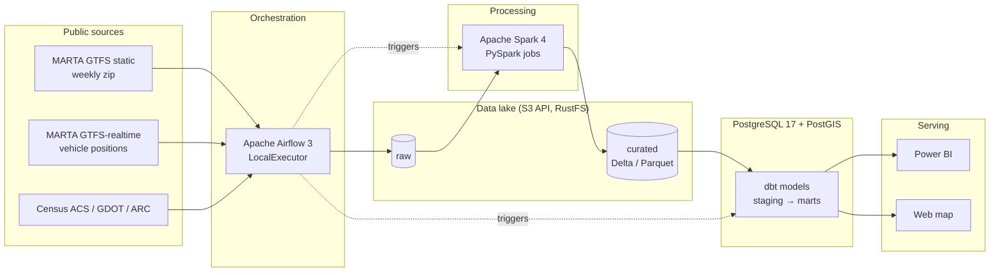

# spark-airflow-data-analyst-portfolio

An end-to-end data platform for **Atlanta transit data (MARTA)**: it ingests public feeds on a schedule with **Apache Airflow**, lands them in an S3-compatible data lake, cleans them with **Apache Spark**, models them with **dbt** in **PostgreSQL/PostGIS**, and serves them to **Power BI** and a public web map.

The whole stack runs **locally for $0** with Docker on a single home server. The code is cloud-portable: the lake speaks the S3 API, the Spark jobs run unchanged on Databricks/EMR, and the dbt project targets Snowflake as well as Postgres.

**Live:** [web map](https://cursorcanis.github.io/spark-airflow-data-analyst-portfolio/) · [dbt docs & lineage](https://cursorcanis.github.io/spark-airflow-data-analyst-portfolio/dbt/)

> Status: **Phase 4 complete.** Realtime capture, Spark/Delta curation, a dbt-modeled PostGIS + H3 warehouse, a GPS validation of the on-time metric, a Power BI kit and a public web map. Key finding: the feed's arrival times run ahead of the buses' own GPS, so "early" is overstated (16.7% → 10.3%) and "late" understated (15.9% → 20.1%). MARTA's realtime feed covers buses only. See the [roadmap](#roadmap).

## Architecture



## Tech stack

| Layer | Local ($0) | Cloud equivalent |
|---|---|---|
| Orchestration | Apache Airflow 3.4 (Docker, LocalExecutor) | MWAA / Astronomer |
| Data lake | RustFS (S3-compatible) | Amazon S3 |
| Processing | Apache Spark 4.2 standalone (PySpark) | Databricks / EMR |
| Warehouse | PostgreSQL 17 + PostGIS 3.7 + H3 | Snowflake |
| Transformation | dbt | dbt |
| BI | Power BI Desktop (read-only `reporting` role) | Power BI Service |
| Web map | MapLibre GL JS on GitHub Pages | same |
| CI/CD | GitHub Actions (ruff, pytest + Spark tests, dbt build against PostGIS/H3, Pages deploy) | |

## Repository layout

```
airflow/dags/        Airflow DAGs
src/atl_transit/     Shared, unit-tested pipeline code (no Airflow imports): ingest, Spark jobs, warehouse SQL, map export
dbt/                 dbt project (staging → intermediate → marts)
tests/               pytest suite (incl. local-Spark tests)
ci/                  dbt CI fixtures and known-answer checks
docker/              Images: Airflow (+dbt venv), Spark (+Delta, S3A, JDBC), Postgres (+PostGIS, H3), RT poller
web/                 Static web map (MapLibre) + data snapshot
bi/powerbi/          Power BI build guide, DAX measures, theme
scripts/             Operator scripts (map snapshot)
docker-compose.yml   The whole platform
.env.example         Configuration template (copy to .env)
```

## Pipelines

| DAG | Schedule | What it does |
|---|---|---|
| `gtfs_static_weekly` | Mondays 06:00 ET | Downloads the MARTA GTFS zip, validates it, skips unchanged feeds (SHA-256), lands zip + tables + manifest in `s3://raw/gtfs_static/` |
| `rt-poller` (service) | every 30 s / 120 s | Polls GTFS-realtime vehicle positions and trip updates into the raw zone |
| `gtfs_rt_hourly` | hourly | Compacts each hour's snapshots into Parquet (dynamic task mapping) |
| `lake_housekeeping` | daily | Raw-zone retention |
| `census_tracts_reference` | manual | Census tracts (TIGERweb) and ACS demographics into PostGIS |
| `spark_curate_gtfs_static` / `spark_curate_rt` | data-aware (Assets) | Spark Connect → Delta Lake: typed tables, deduped GPS, observed vs scheduled arrivals (idempotent MERGE) |
| `warehouse_load_gtfs_static` / `warehouse_load_rt` | data-aware | Spark JDBC → load table → one-transaction publish into Postgres |
| `warehouse_load_rt_gps` | daily 04:30 ET | Spark: per-fix bus speeds + arrival-vs-GPS check, into Postgres |
| `dbt_build` | any warehouse asset | `dbt build` (models + 63 tests) and source freshness |

## Run it

Requirements: Docker with Compose v2 and about 8 GB of free RAM.

```bash
cp .env.example .env          # then replace every change-me
docker compose up -d
```

| UI | URL |
|---|---|
| Airflow | http://localhost:8080 |
| Lake console (RustFS) | http://localhost:9001 |
| Spark master | http://localhost:8081 |

Unpause `gtfs_static_weekly` in Airflow, or trigger it manually.

Run the tests: `pip install -e ".[dev]" && pytest`

A full step-by-step explanation of how every component is wired together is in [docs/BUILD_GUIDE.md](docs/BUILD_GUIDE.md).

## Roadmap

- [x] **Phase 0: Foundation.** Docker platform, CI, first ingest DAG (GTFS static)
- [x] **Phase 1: Ingest.** GTFS-realtime vehicle positions every few minutes, plus reference data (Census tracts)
- [x] **Phase 2: Spark.** PySpark curation via Spark Connect into Delta Lake (dedupe, typed schemas, observed vs scheduled arrivals, idempotent MERGE), plus Census ACS demographics
- [x] **Phase 3: Warehouse.** Spark JDBC load with atomic publish; dbt star schema in Postgres/PostGIS (spatial stop-to-tract join, incremental fact, on-time and equity marts), 32 tests + freshness, dbt CI against PostGIS
- [x] **Phase 4: Geospatial + BI.** GPS validation of the arrival metric (Spark range join), H3 hexagon bus speeds, stop-to-stop delay segments, read-only BI role + Power BI kit, public MapLibre web map and dbt docs on GitHub Pages. (Passenger origin-destination data isn't public for MARTA, so the "flow" view is segment delay.)
- [ ] **Phase 5: Hardening.** Data-quality suite, Terraform, scheduled operations
- [ ] **Stretch:** streaming ingest (Redpanda/Kafka), natural-language Q&A over the marts (local LLM), Snowflake run of the dbt project

## Data sources

- MARTA GTFS static feed: https://www.itsmarta.com/google_transit_feed/google_transit.zip
- MARTA GTFS-realtime (vehicle positions, trip updates): https://gtfs-rt.itsmarta.com/
- U.S. Census Bureau: TIGERweb tract boundaries and the ACS 5-year API
- Basemap: OpenFreeMap / OpenStreetMap contributors
