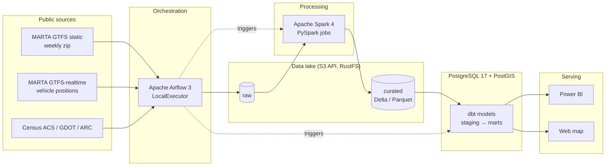

# spark-airflow-data-analyst-portfolio

An end-to-end data platform for **Atlanta transit data (MARTA)**: it ingests public feeds on a schedule with **Apache Airflow**, lands them in an S3-compatible data lake, cleans them with **Apache Spark**, models them with **dbt** in **PostgreSQL/PostGIS**, and serves them to **Power BI** and a public web map.

The whole stack runs **locally for $0** with Docker on a single home server. The code is cloud-portable: the lake speaks the S3 API, the Spark jobs run unchanged on Databricks/EMR, and the dbt project targets Snowflake as well as Postgres.

> Status: **Phase 0, foundation.** The infrastructure and the first ingest DAG are running. See the [roadmap](#roadmap).

## Architecture



## Tech stack

| Layer | Local ($0) | Cloud equivalent |
|---|---|---|
| Orchestration | Apache Airflow 3.4 (Docker, LocalExecutor) | MWAA / Astronomer |
| Data lake | RustFS (S3-compatible) | Amazon S3 |
| Processing | Apache Spark 4.2 standalone (PySpark) | Databricks / EMR |
| Warehouse | PostgreSQL 17 + PostGIS 3.7 | Snowflake |
| Transformation | dbt | dbt |
| BI | Power BI Desktop | Power BI Service |
| CI | GitHub Actions (ruff, pytest, compose validation) | |

## Repository layout

```
airflow/dags/        Airflow DAGs
src/atl_transit/     Shared, unit-tested pipeline code (no Airflow imports)
tests/               pytest suite
docker/postgres/     Database bootstrap (Airflow metadata DB + PostGIS warehouse)
docker-compose.yml   The whole platform
.env.example         Configuration template (copy to .env)
```

## Pipelines

| DAG | Schedule | What it does |
|---|---|---|
| `gtfs_static_weekly` | Mondays 06:00 ET | Downloads the MARTA GTFS zip, validates the required files and row counts, skips the run if the feed is unchanged (SHA-256), and lands the zip, each table, and a JSON manifest in `s3://raw/gtfs_static/ingest_date=YYYY-MM-DD/` |

## Run it

Requirements: Docker with Compose v2 and about 8 GB of free RAM.

```bash
cp .env.example .env          # then replace every change-me
docker compose up -d
```

| UI | URL |
|---|---|
| Airflow | http://localhost:8080 |
| Lake console (RustFS) | http://localhost:9001 |
| Spark master | http://localhost:8081 |

Unpause `gtfs_static_weekly` in Airflow, or trigger it manually.

Run the tests: `pip install -e ".[dev]" && pytest`

A full step-by-step explanation of how every component is wired together is in [docs/BUILD_GUIDE.md](docs/BUILD_GUIDE.md).

## Roadmap

- [x] **Phase 0: Foundation.** Docker platform, CI, first ingest DAG (GTFS static)
- [ ] **Phase 1: Ingest.** GTFS-realtime vehicle positions every few minutes, plus reference data (Census tracts)
- [ ] **Phase 2: Spark.** PySpark curation jobs (dedupe, schema enforcement, H3 indexing) to Delta/Parquet
- [ ] **Phase 3: Warehouse.** dbt star schema in Postgres/PostGIS with tests, run in CI
- [ ] **Phase 4: Geospatial + BI.** Origin-destination matrix, on-time performance by corridor, Power BI report, web map
- [ ] **Phase 5: Hardening.** Data-quality suite, Terraform, scheduled operations
- [ ] **Stretch:** streaming ingest (Redpanda/Kafka), natural-language Q&A over the marts (local LLM), Snowflake run of the dbt project

## Data sources

- MARTA GTFS static feed: https://www.itsmarta.com/google_transit_feed/google_transit.zip
